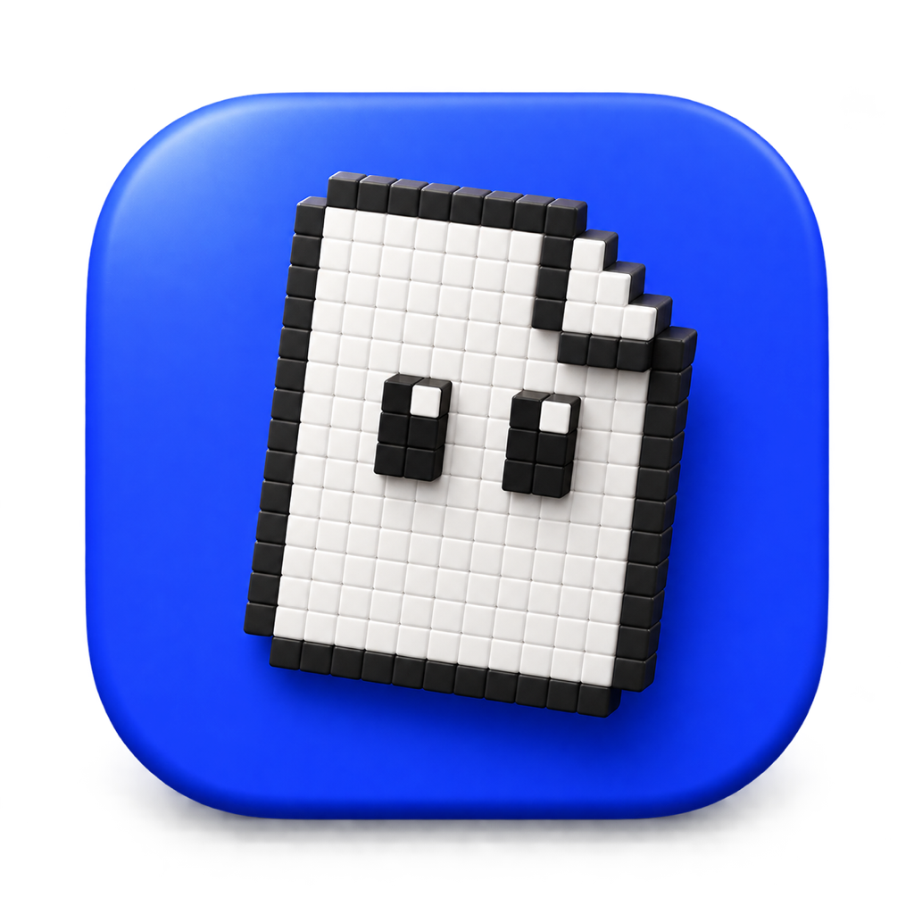

<p align="center">
  
</p>

<h1 align="center">Tavla</h1>

<p align="center">A free, open source design tool for posters, slides, videos and invites.<br />It runs in your browser, works offline, and your files stay on your machine.</p>

---

Tavla is a Canva alternative built from scratch: a real canvas editor with pages, smart guides, text effects, photo editing, charts, animation, presenting and export, plus the features Canva keeps behind its Pro plan (background removal, magic resize, brand kits, bulk create, transparent PNG, SVG export, version history, custom fonts), given to everyone.

There is no account and no server. Designs live in the browser's IndexedDB. Live collaboration goes peer to peer over WebRTC, encrypted with the key in the share link.

## What is in here

```
apps/editor    the editor (React 19, TypeScript, Yjs, Vite)
apps/site      the marketing and download site (vanilla TypeScript, three.js for one voxel eye)
apps/desktop   Electron shell that packages the editor as a desktop app
research/      design synthesis from the reference board and the Canva teardown
assets/        the Codex briefs used to make Tavla's photos, voxel objects and textures
qa/            Playwright scripts used to check the editor end to end
```

## Run it

```bash
npm install
npm run dev          # editor on http://localhost:5181
npm run dev:site     # site on http://localhost:5182
npm run build        # site into dist/, editor into dist/app/
npm test -w @tavla/editor   # unit tests (vitest)
```

Browser tests live in `qa/` (Playwright scripts against the dev server).

Desktop app (macOS, from `apps/desktop`): build the editor, copy `dist/app` to `apps/desktop/app`, then `npx electron-builder --mac dmg`.

## Features

**Canvas.** Pages stacked or in a grid, zoom from 5% to 800%, pinch and ctrl scroll zoom around the cursor, space to pan, rulers with draggable guides, a layout grid, smart guides for edges, centres and equal gaps with the spacing written on the guide, marquee selection, alt drag to duplicate, drag elements between pages.

**Elements.** 23 shapes with fills, gradients, borders and rounded corners; lines with arrowheads, dashes and bends; photo frames in any shape; Tavla's own voxel objects, characters and glass shapes; 200,000 icons through Iconify; charts (column, bar, line, area, pie, donut, progress) with a data editor that takes pasted spreadsheets; tables; QR codes; freehand drawing with pen, marker, highlighter, glow pen and eraser; a vector pen (click for corners, drag for curves, edit every point afterwards) and shape combining (union, subtract, intersect, exclude); connector lines that stick to shapes and follow them, pulled out of any selection from its connect dots; video clips with in place playback, filmstrip trimming, volume and loop.

**Text.** Its own line layout, so the screen, PNG, SVG and PDF all break lines in the same place. 1,344 Google Fonts plus your own font files, weights, italic, underline, strike, uppercase, letter and line spacing, lists, alignment, gradients, curved text, and ten effects: shadow, lift, hollow, splice, outline, echo, glitch, neon, highlight.

**Photos.** Crop by dragging inside the frame, masks, borders, twelve filters, eight adjustment sliders, duotones, vignette, grain, and background removal that runs on your machine (BiRefNet lite, MIT licence, through transformers.js).

**Pages and motion.** Backgrounds in colour, gradient, photo or texture; page transitions; ten entrance animations with delay and duration; speaker notes; Present mode with autoplay; hidden pages.

**Organise.** Layers panel with drag to restack, hide, lock and rename; group, align, distribute and tidy; numeric position panel; copy and paste style; find and replace; add to every page; alt text.

**Make more.** Magic resize into any format, in place or as a copy. Bulk create: paste a table and get a page per row. Brand kits with logos, colours and fonts. 32 templates. Version history with a snapshot every ten minutes. A command palette on ⌘K with every action.

**Export.** PNG (transparent, up to 4×), JPG, WebP, SVG, PDF for screen or print with live links and bleed, PowerPoint with editable text, MP4 video of pages, animations and clips with their mixed sound (WebCodecs), GIF, multi page ZIP, and the editable `.tavla` file (video clips included).

**Import.** `.tavla` files and PDFs (each page comes in as a picture).

**Share.** A live link for real time editing with cursors and selections of everyone in the room, peer to peer and encrypted.

## Architecture in one paragraph

A design is a Y.Doc: `meta`, `pageOrder`, `pages` and `elements` maps, plus `assets` holding image bytes so a design is complete on its own. `DesignDoc` keeps an immutable snapshot for React and routes every local edit through one transaction origin, which drives undo, persistence (y-indexeddb) and collaboration (a small PeerJS based Yjs provider, `collab/peerProvider.ts`) from the same data. Video bytes are the exception: they live in their own IndexedDB store so version history and live sync stay light, and the design keeps a poster frame. Rendering is SVG: the same `PageView` draws the canvas, thumbnails, Present mode, and exports (rendered to a string with fonts and images inlined, then rasterised). Interaction lives in an HTML overlay above each page. See `research/canva/02-document-model.md` for how this compares with Canva's model.

## Licence

MIT. The photos, voxel objects, characters and textures in `apps/editor/public/library` were made for Tavla and are free to use for anything. Icons from Iconify and photos from Openverse keep their own licences.
