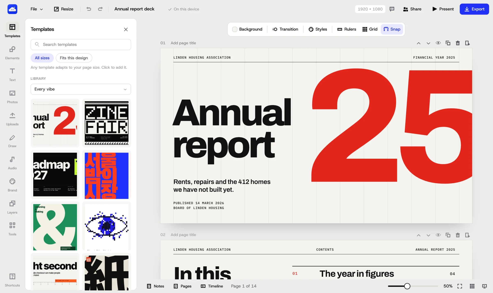

<p align="center">
  
</p>

<h1 align="center">OpenTempl</h1>

<p align="center">
  A free design app for posters, social posts and slides.<br>
  No account, no paywall, and your designs stay on your computer.
</p>

<p align="center">
  <a href="https://opentempl.org"><b>opentempl.org</b></a>
  &nbsp;·&nbsp;
  <a href="#install-the-desktop-app">Desktop app</a>
  &nbsp;·&nbsp;
  <a href="#features">Features</a>
  &nbsp;·&nbsp;
  <a href="CONTRIBUTING.md">Contribute</a>
</p>

<p align="center">
  <a href="#install-the-desktop-app"></a>
  <a href="LICENSE"></a>
  <a href="https://x.com/fsconfig"></a>
</p>

<p align="center">
  <a href="https://x.com/fsconfig">
    <picture>
      <source media="(prefers-color-scheme: dark)" srcset=".github/readme/made-by-dark.svg">
      
    </picture>
  </a>
</p>

<p align="center">
  
</p>

OpenTempl is for the things people make every week: a poster for a gig, an Instagram post, a menu, a set of slides. It starts from a template or a blank page, and you change the words, colours and photos until it is yours. Everything you would normally pay to unlock is included, such as transparent PNG, SVG export, background removal and brand colours.

Designs are saved in your browser or in the desktop app, as files you own. There is no OpenTempl account and no server that keeps your work. It is an alternative to Canva, written from scratch, with one maintainer.

## Features

- **Templates.** 337 templates in 34 styles, from Swiss grid and brutalist to riso zine and quiet luxury, including 12 full presentation decks. Any template adapts to the page size you pick.
- **Editor.** Pages, smart guides, layers, text effects, charts, tables, a vector pen, photo editing, animation, speaker notes and Present mode. A design check flags low contrast, tiny text and soft photos.
- **Start page.** Pick a size for posters, social posts, slides, cards and print, or type your own.
- **Generate.** Describe a design and, with your own OpenAI key, it is made in the editor and opens as layers. Without a key, use ChatGPT for free: OpenTempl writes the prompt and you bring the picture back.
- **Photos.** Search Unsplash from inside the editor, or use the photos and textures that ship with the app.
- **Live sharing.** One link, anyone with it can edit, with cursors. Changes sync through an end to end encrypted relay that cannot read your design.
- **Import.** PDF and PowerPoint files come in with editable text.
- **Export.** PNG, JPG, PDF, SVG, PowerPoint and GIF, plus video of animated pages.
- **Offline.** Works offline after the first load.
- **For AI assistants.** An MCP server lets Claude, ChatGPT, Cursor and other assistants design in OpenTempl: search templates, build and edit designs, check a rendered preview of every change, and hand you a link that opens the result in the editor. Add `https://opentempl.org/api/mcp` as a connector; [setup for each app](https://opentempl.org/mcp).

Not here yet: team workspaces, a phone app, CMYK output.

## Install the desktop app

The whole editor in its own window, offline. One line installs the latest release, after checking it against the release checksums.

**macOS and Linux.** Paste into Terminal:

```sh
curl -fsSL https://opentempl.org/install.sh | sh
```

**Windows.** Paste into PowerShell:

```powershell
irm https://opentempl.org/install.ps1 | iex
```

Run the same line again to update. The scripts are [install.sh](apps/editor/public/install.sh) and [install.ps1](apps/editor/public/install.ps1). On Linux the script uses apt on Ubuntu and Debian and installs into your home folder elsewhere.

You can also download the files from [opentempl.org/download](https://opentempl.org/download) or the [Releases](https://github.com/noah-thing/opentempl/releases/latest) page. They are not code signed yet, so the first time you may need to right click the app and choose Open (macOS), or choose More info, then Run anyway (Windows). The one line install skips that step.

## Quick setup

**In the browser.** Open [opentempl.org](https://opentempl.org). Nothing to install.

**From source.** Requires Node.js 22 or newer.

```sh
git clone https://github.com/noah-thing/opentempl.git
cd opentempl
npm install
npm run dev        # the editor on http://localhost:5181
```

Tests, templates and desktop builds are covered in [CONTRIBUTING.md](CONTRIBUTING.md).

## Privacy

OpenTempl counts anonymously how many copies are in use and how often a few actions happen, such as an export. You can switch the counts off under File, Share anonymous counts. The newsletter form is optional. Nothing else leaves your device unless you share a design, and then it is encrypted first. The full list is in [docs/PRIVACY.md](docs/PRIVACY.md).

## Project layout

```
apps/editor/     the editor (React, TypeScript, Yjs, Vite); also what opentempl.org serves
apps/desktop/    Electron shell that packages the editor for macOS, Windows and Linux
apps/site/       an earlier marketing site, no longer deployed
api/             Vercel functions: the Unsplash proxy and the MCP server endpoint
mcp/             the MCP server: tools, the design guide, and the draft format the editor also reads
drafts/          Cloudflare Worker that keeps MCP designs until opened and renders their previews
stats/           Cloudflare Worker for the anonymous counts and the email list
sync/            Cloudflare Worker for the encrypted live sharing relay
seo/             generator for the static pages on opentempl.org (guides, templates, sitemap)
scripts/         template build tools
qa/              Playwright scripts that drive the editor
docs/            architecture and privacy notes
```

The template library is source code in `apps/editor/templates`, one file per style. See [docs/ARCHITECTURE.md](docs/ARCHITECTURE.md) for how the pieces fit.

## Contributing

Bug reports, fixes and new templates are welcome. Read [CONTRIBUTING.md](CONTRIBUTING.md) first, and open an issue before starting anything large. Security problems go through [SECURITY.md](SECURITY.md).

## License

MIT, Copyright (c) 2026 Noah. The photos, objects and textures in `apps/editor/public/library` were made for OpenTempl and are free to use for anything. Icons from Iconify keep their own licences, and photos you place from Unsplash are under the Unsplash License, credited to the photographer.

OpenTempl is not affiliated with Canva.
